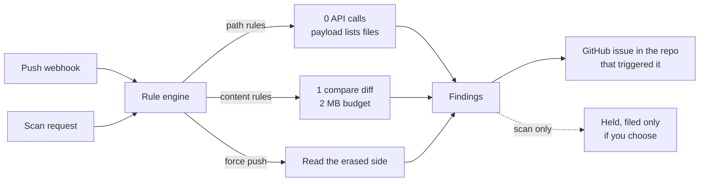
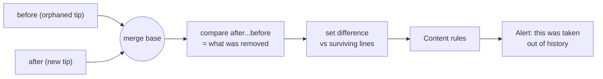
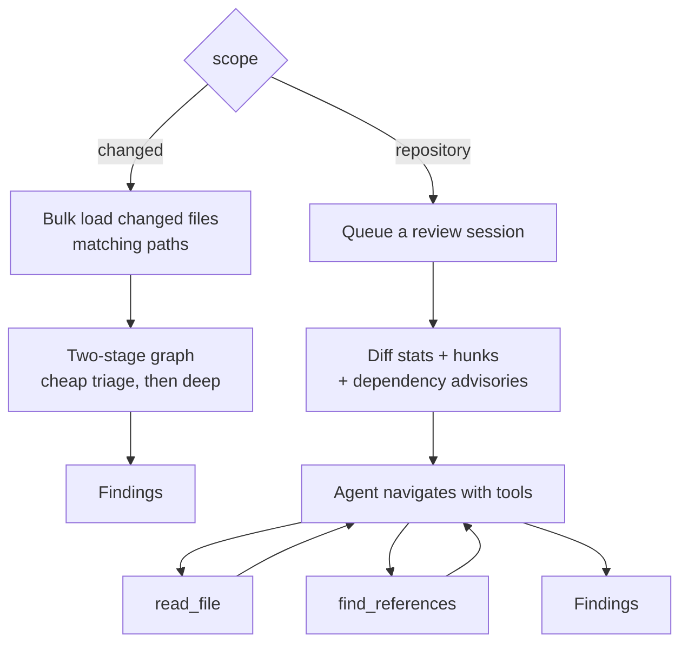
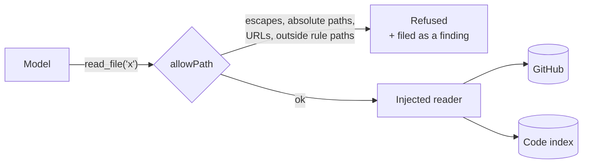
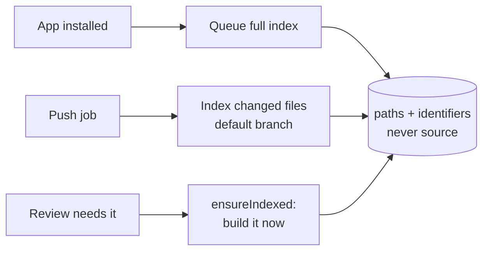

# Pushguard

Org-wide push monitoring for GitHub. One App install watches every repository,
evaluates each push against your rules, and opens a ticket naming the pushing
account: force pushes, install hooks, workflow tampering, obfuscated payloads,
or any file you decide to watch.

Built for the attack where a compromised teammate force-pushes code that runs on
everyone else's machine at the next pull.

[`RUNTIME.md`](RUNTIME.md) is the visual map: what runs when, and how many API
calls each path costs. [`AI_REVIEW.md`](AI_REVIEW.md) covers the AI architecture.
[`DESIGN.md`](DESIGN.md) holds the decisions and what they replaced.

## How it works



Watching is the product; scanning is how you see what it finds before installing
anything.

- **Zero configuration.** Installing seeds nothing — the 83-rule catalog ships
  with the code, so detection is live on the first push with no database write.
- **Rules belong to the org.** Org admins edit them; members read. Narrow an
  individual rule with its own `repos` patterns.
- **Alerts are GitHub issues**, filed in the repository that triggered them. A
  **public** repo gets the alert but not the evidence: rule, severity, files and
  commits are named, matched lines withheld with a pointer to the dashboard.
  Quoting them would turn an alert about a leaked secret into a search-indexed
  copy of it. A private repo quotes in full.
- **No cache, no TTL.** Stored GitHub data, including which repositories each
  user may read, is a projection maintained by webhooks. Missed deliveries are
  found in the App's delivery log and redelivered.
- Multi-tenant: one deployment, any number of organizations.

### Force-push forensics

A force push is the only push that removes evidence instead of adding it. Once it
lands the old tip is unreachable — `git clone` gets the survivors, and so does
every scanner that reads a checkout.



The order is the whole trick: **new tip as base, orphaned tip as head**. Reversed,
it returns the surviving side — plausible, and it detects nothing. The set
difference is what separates "removed from history" from "rebased", which
developers do all day.

Time-sensitive: `before` is unreachable from any branch the moment the push
lands, so this runs in the push job seconds after the webhook, never on a schedule.

## Scanning

Reads what is already committed instead of waiting for a push.

- **GitHub decides what you may scan.** The picker lists the repositories GitHub
  says you can read (the `repo_access` projection); the same check runs again
  when the scan is queued. Naming another repository in the request gets a 403.
  An installation token is never used to decide access — it sees more than any
  one member may read.
- Every result records what it read: branch, commit count, SHA range, compare
  link. "Nothing flagged" is distinguishable from "never looked at".
- **Nothing is filed on GitHub.** Filing is a separate, deliberate action, and
  access is re-checked at that moment.
- **A scan cannot answer every rule.** Rules keyed on the push event (`forced`,
  branch created, `hour_utc`) are dropped — a snapshot has nothing to answer them
  with. That is the honest limit of scanning, and the reason to install.
- Limits: 25 scans/day, 20 repos each, one at a time per account (enforced by a
  unique partial index, not a read-then-write).

## Rules

83 rules in `lib/rules/catalog/`, 17 packs. A file, not a table. The database
holds only what you **changed** — an override, or a rule you wrote.

A pack is a grouping label, not a scope. Nobody declares a repository is C++;
ecosystem rules are scoped by their own `paths`.

Rules are checked for catastrophic backtracking (`recheck`) **when written**, not
when read: a pattern like `(\w+\s?)+=` lets an attacker hang the scanner on
demand, and a detector that goes quiet is worth more to them than the rule is to
you.

See [`public/rules.example.yaml`](public/rules.example.yaml) for the schema by
example — also served at `/rules.example.yaml` on a running instance.

## AI rules

A rule a model answers. It fires on its own `paths`, never as an escalation on a
regex hit — that would mean it could only ever find what the regex already found.

| | Pattern rule | AI rule |
|---|---|---|
| Cost | free, every push | metered |
| Answer | deterministic | judgement |
| Finds | what you predicted | what you did not |

`scope` picks which pipeline runs:



**`changed`** runs inside the push job. Bulk-loads the files the rule's `paths`
match, sends them through a cheap triage model, and escalates only what triage
flags. Caps: 10 rules/push, 10 files/rule, 40k chars/file, 120k/rule.

**`repository`** runs as a resumable background job. The agent gets the diff as
orientation, then navigates the tree by reading files and following names.

### The model never holds a credential

Every file under review is attacker-controlled — that is the premise. So the
model gets *tools*, not a token. It emits a path; our code decides whether it
gets one.



An injected instruction can only produce a *rejected argument*. Refusals are
themselves reported as `ai-rule-left-its-scope` — that is where injection
surfaces. The tool layer imports neither the database nor Octokit; guards in the
test suite keep it that way.

### The code index

`find_references` answers from our own index, costing zero GitHub calls. GitHub
has no call-graph API, and code search is 10 req/min, default-branch only, and
lags — none of which a review can build on.



Blob-SHA diffing means unchanged files are never re-read: a one-file push costs
one batch.

Reads use one tree call (which carries sizes, so oversized files are skipped
without being fetched) plus GraphQL batches of ~40 files. **200 files = 6 calls,
not 200.**

It answers *mentions*, not call sites. It narrows 3,000 files to 9 for the model
to read properly. It is not a call graph.

### Cost controls

| Control | Value |
|---|---|
| Model reviews per org per day | 200 |
| AI rules stored per org | 50 |
| Tool calls per repository rule | 5–120, default 40 |
| Rules run per push | 10 |

Each rule may name its own key, so a noisy rule runs on a cheap model and the
one that matters on a capable one.

## Blind spots are findings, never silence

The rule the whole codebase follows: **"we did not look" must be reported**,
because a reader cannot tell it from "nothing found".

`diff-not-fully-read` · `ai-rule-did-not-run` · `repo-index-incomplete` ·
`file-not-fully-read` · `ai-rule-left-its-scope` · `dependency-known-advisory`

Related: every limit in a scanner is a place to put things. Matched lines have no
length cap — there was one, and it was a bypass.

## Setup (operator)

Every variable is documented in [`.env.example`](.env.example); copy it to
`.env`. `lib/env.ts` refuses to start without the required ones.

1. **Database** — Supabase Postgres (or any Postgres with `pgmq`, `pg_net`,
   `pg_cron` and Vault).
   - Local: `npm run db:local` starts `supabase/postgres` in Docker on port
     54329, applies `drizzle/`, and prints `DATABASE_URL` / `DATABASE_ADMIN_URL`.
   - Hosted: set `DATABASE_ADMIN_URL` (the `postgres` role, session pooler) and
     run `npm run db:migrate`. Then, once, in the SQL editor: set the
     `pushguard` role's password and create the two Vault secrets the queue
     uses to wake the app (`jobs_run_url`, `jobs_run_secret`; the exact
     statements are in `.env.example`). Set `DATABASE_URL` to the `pushguard`
     role on the transaction pooler (port 6543).
   - Coming from the Mongo version: `npm run db:copy-mongo` with `MONGODB_URI`
     set, once.

2. **GitHub App** — public app, webhook `https://<your-app>/api/webhook`, Setup
   URL `https://<your-app>/api/install/complete`. Permissions and the event list
   are in `.env.example`.

   | Permission | Level | Why |
   |---|---|---|
   | Repository → Metadata | Read | required; lists installed repos |
   | Repository → Contents | Read | compare diffs, file reads |
   | Repository → Issues | **Read & write** | create alerts |
   | Repository → Pull requests | Read | PR evaluation; did a commit arrive through review |
   | Repository → Administration | Read | branch protection and ruleset events |
   | Organization → Members | Read | org roles and teams |

   Pushguard deliberately does not request `administration: write`, so it cannot
   create repositories — which is why alerts land in the repo that triggered
   them. Detonation runs on Pushguard's own runner repo (`RUNNER_REPO`); see
   [`runner/README.md`](runner/README.md).

3. **Sign-in** — use the **same App**, not a separate OAuth App. Its client ID
   and secret go in `AUTH_GITHUB_ID` / `AUTH_GITHUB_SECRET`; set `AUTH_URL` to
   the public origin.

   | Setting | Value |
   |---|---|
   | Request user authorization (OAuth) during installation | on |
   | Callback URL **#1** | `https://<your-app>/api/install/complete` |
   | Callback URL **#2** | `https://<your-app>/api/auth/callback/github` |
   | Expire user authorization tokens | on (sessions refresh the token) |

   Order matters: GitHub redirects post-install to the *first* callback; Auth.js
   sends its own `redirect_uri` and always gets the second.

4. **Deploy** to Vercel with the same variables, minus `DATABASE_ADMIN_URL` and
   `MONGODB_URI`. `CRON_SECRET` must equal the `jobs_run_secret` Vault value:
   it is the bearer the database sends to `/api/jobs/run`. There is no Vercel
   cron; the database wakes the app when a job is queued or comes due.

## Setup (each organization)

1. Install the App on the org, all repositories. It registers itself via webhook.
2. Sign in. The header switcher changes which org you are viewing;
   **All organizations** merges the alert feed.
3. Optional, in Settings: choose who gets mentioned and assigned — a dropdown of
   what the app can actually see, so it cannot be a typo.
4. Optional, in Settings: a Slack or Discord webhook. New alerts go there, and so
   do meta-alerts (uninstall, repo removed, alert deleted or closed by the account
   that triggered it, missed webhooks), which never become in-repo issues.

## Development

```
npm install
npm run db:local         # Postgres with pgmq / pg_net / pg_cron, migrated
npm run dev              # dashboard on localhost:3000
npm run typecheck
npm run lint
npm test
npm run validate:rules   # the example file parses, no regex can hang
npm run db:generate      # new migration after a schema change in lib/db/
```

All three of typecheck, lint and test must pass before work is done.

Behind a CDN in development? Make sure it is not caching `/_next/*`. Turbopack
reuses chunk filenames across rebuilds, so a cached chunk gets served for a URL
whose contents changed — edits that never appear, or a `module factory is not
available` error that survives restarts.

## License

MIT
