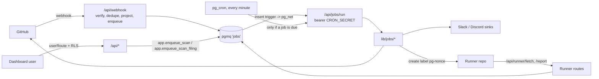
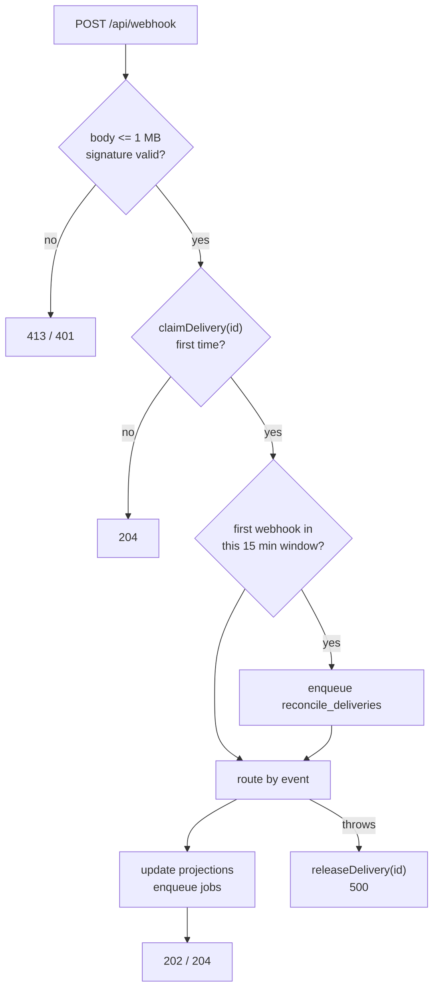
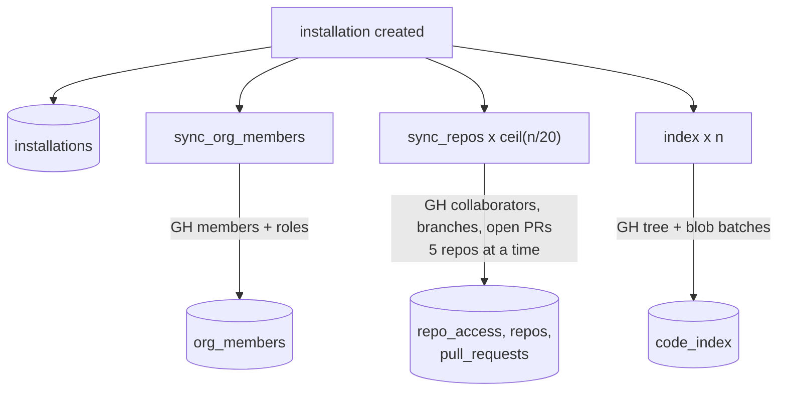
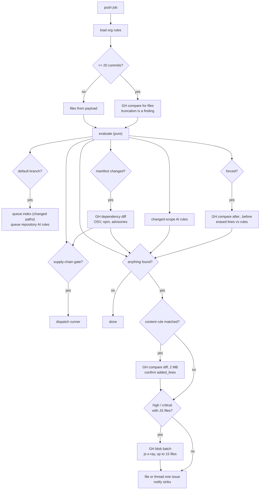
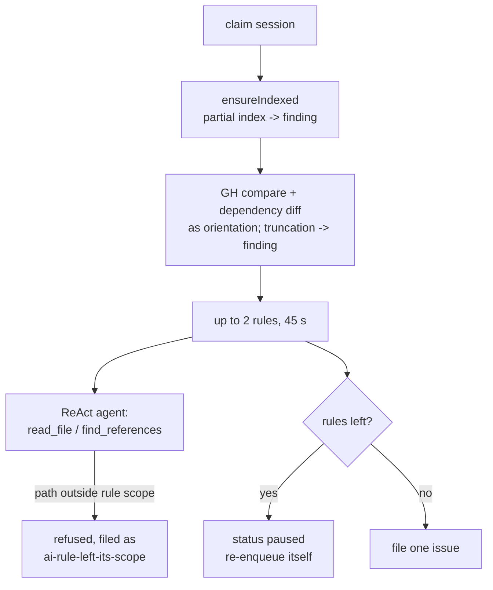
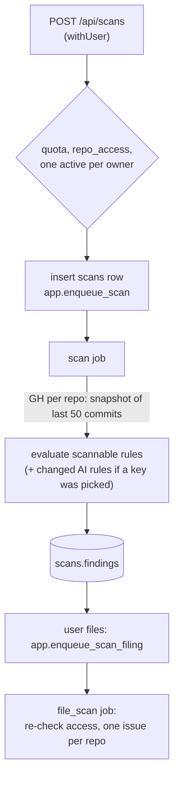
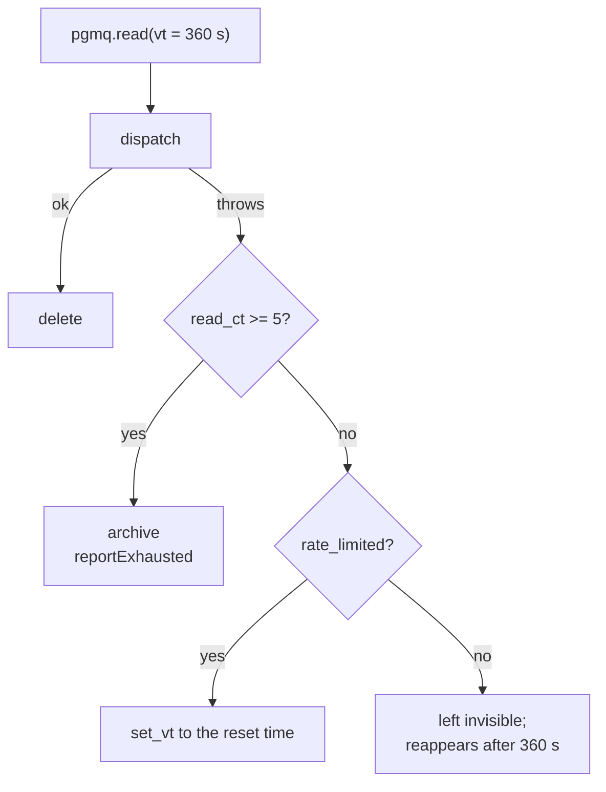
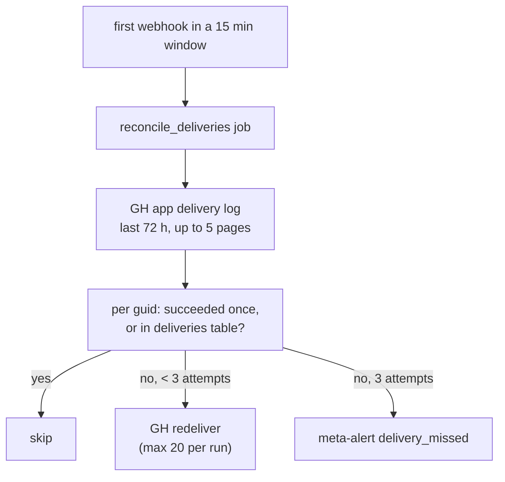
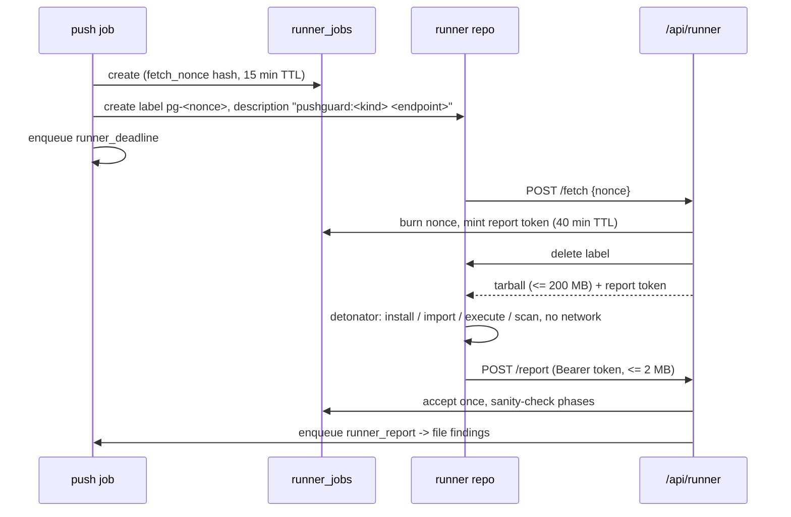

# How it runs

Each section is one real path through the code. `GH` marks a GitHub API call;
everything else is Postgres or pure computation. Reasons for the shape live in
`DESIGN.md`.

## Moving parts

- **Two database roles.** Every statement runs inside `withUser(login)` (role
  `pushguard_app`, RLS keyed on `app.login`) or `asSystem()` (role
  `pushguard_system`, explicit per-table system policies). The login role
  `pushguard` is `NOINHERIT` and can do nothing until `q()` switches role.
- **One queue.** `pgmq` queue `jobs`. Each message is a `schemas/job.ts` union
  member, parsed on send and on read; an unparseable message is archived.
- **Waking.** A statement-level insert trigger on `pgmq.q_jobs` calls
  `app.post_jobs_run()`, which `net.http_post`s to the URL and bearer held in
  Supabase Vault (`jobs_run_url`, `jobs_run_secret`). A delayed or retried job
  has no insert to wake it, so `pg_cron` runs `app.wake_due_jobs()` every
  minute; it posts only when some message has `vt <= now()`.

## 1. Webhook

The handler runs entirely as `asSystem`. It does only cheap writes: projections
(repos, branches, members, alert state, open PRs) and enqueues. Anything that
calls GitHub or a model is a job. A failed handler releases its delivery id so a
redelivery is not deduplicated away.

| Event | Handler does | Job queued |
|---|---|---|
| `installation` created / unsuspend | register installation (revives a suspended row) | `sync_org_members` (orgs), `sync_repos` per 20 repos, `index` per repo |
| `installation` deleted | deactivate | `uninstall` (meta-alert, then delete all org data) |
| `installation` suspend | meta-alert, deactivate, purge projections and index | `meta_alert` |
| `installation_repositories` | add / remove repos; removal is a meta-alert | sync + index for added |
| `push` | record first push, note branch, flood counter | `push` |
| `pull_request` | upsert / delete the open-PR row | `pull_request` on opened, reopened, synchronize, ready_for_review |
| `member`, `membership`, `team` | | `sync_repo_access`, `sync_team_member`, `sync_team_repo` |
| `organization` | member added / removed (revokes access), renamed, deleted | |
| `issues`, `issue_comment` | mirror alert state; delete, transfer, unlabel, close-by-actor are meta-alerts | `meta_alert` |
| `public` | mark repo public | `public_alert` |
| `deploy_key`, `branch_protection_rule`, `repository_ruleset` | classify | `settings_alert` (repo) or `meta_alert` (org ruleset) |
| `create`, `delete`, `repository` | branches, default branch, renames, deletions | |

## 2. Install

No rules are written: the catalog (83 rules, 17 packs) ships as code. Detection
is live on the first push. Sign-in records the user's own org roles once
(`recordMemberships` in `lib/auth.ts`); a personal account's owner is its admin.

## 3. Push

A push of fewer than 20 commits that matches nothing, is not forced, touches no
manifest and has no AI rule in scope makes no GitHub call. A rule that asks `unreviewed` adds one
commit-to-PR lookup, only when that rule's repo and branch match. Extra findings
on a push: `push-flood` (over 60 pushes a minute per installation, still
evaluated), `tag-moved` (critical), compare truncation, dependency signals.

The first-push signal is recorded in the webhook, not the job, so a retried job
does not see the sender as already known.

## 4. Pull request

The job reads one compare, `base.sha...head.sha`, and evaluates it as a whole
with `branches` matched against the base. Changed-scope AI rules run on the same
files; repository-scope rules are queued. A repeat event threads onto the open
alert instead of filing again. The PR gets one comment pointing at the issue, once per alert.

## 5. AI rules

- **`scope: changed`** runs inside the push or PR job. Files the rule's `paths`
  match are batch-read (shared across rules), compacted, then a two-stage
  LangGraph graph (`lib/review-graph.ts`) triages and, if worth it, reviews
  deeply. Verdicts come back through `withStructuredOutput(..., { method:
  "jsonSchema" })`. A rule that could not answer files `ai-rule-did-not-run`.
- **`scope: repository`** is queued as a `review_session` (seeded with the
  changed source files, or a scan's flagged files). Each job slice:

Both paths claim against the per-org daily model cap before spending.

## 6. Scan

A user can queue exactly two kinds of job, both through `SECURITY DEFINER`
functions that check ownership: their own queued scan and their own finished
scan's filing. Raw queue access would let a user forge a push job that runs as
the system. A scan failure is written to the scan, not retried.

## 7. Job retry and exhaustion

One invocation runs jobs one at a time for up to 240 s and starts none with
less than 60 s left; parallelism is several invocations. Exhaustion is reported,
never dropped: a push or PR files `change-not-evaluated` or
`github-rate-limited`; a scan or review session is marked failed. An `index` job
that paused on a low rate budget re-queues itself 600 s later.

## 8. Delivery reconciliation

Reconciliation is triggered by traffic, not a schedule: the first webhook after
an outage of up to three days recovers what was lost. An org with no webhooks
at all is not reconciled until one arrives.

## 9. Runner

Dispatch happens only on the default branch when a JavaScript supply-chain rule
or a dependency signal fires, or a rule's `detonate` response asks. Detonation
always runs on Pushguard's private `RUNNER_REPO`, which has a monthly quota per
org (`detonation-quota-reached`, filed once). Without `RUNNER_REPO` it is logged
(`runner_not_configured`), not filed. The label name is sealed on the job so an
unfetched job's label is deleted at its deadline. `runner_deadline` closes jobs that never
fetched or never reported and files `detonation-unavailable` or
`detonation-timed-out`; while a job is still inside its window it re-queues
itself. A report that fails sanity checks (phase order, durations against
budget, wall clock since fetch) files `detonation-report-suspect`.

## 10. Alerts and sinks

Every finding batch becomes one GitHub issue in the repository that triggered
it, or a comment on an open alert for the same rules. Each new issue also goes
to the org's Slack-compatible sinks (Discord via `/slack`). Meta-alerts, which
report Pushguard losing sight of something (uninstall, suspend, repo removed,
alert deleted / unlabeled / closed by the triggering account, org ruleset
changed, missed delivery), go only to sinks: the in-repo issue is what the
actor can close.

## 11. Dashboard

Every page and route reads Postgres under `withUser`, so RLS decides what rows
exist. `requireTenant` / `requireAdmin` (`lib/tenant.ts`) resolve the selected
org from `org_members` and `repo_access`; an org the user cannot see is 404,
one they see but do not administer is 403. Responses go through `respond()` with
a zod output schema, which strips unnamed columns. No dashboard read calls
GitHub; scans and filings are jobs.

## Limits

| What | Value | Constant |
|---|---|---|
| Webhook body | 1 MB | `PAYLOAD_MAX_BYTES` (`app/api/webhook`) |
| Pushes per installation before `push-flood` | 60 / min | `WEBHOOK_PUSHES_PER_MINUTE` |
| User requests | 120 / 60 s per login | `USER_REQUESTS_PER_WINDOW` |
| `/api/jobs/run` calls | 120 / min | `JOBS_RUN_PER_MINUTE` |
| Runner endpoint calls | 30 / 60 s per address | `RUNNER_REQUESTS_PER_WINDOW` |
| Job visibility / attempts | 360 s / 5 | `JOB_VISIBILITY_SECONDS`, `JOB_MAX_ATTEMPTS` |
| Job run budget / start floor | 240 s / 60 s | `JOB_RUN_BUDGET_MS`, `JOB_START_FLOOR_MS` |
| Repos per sync job | 20 | `SYNC_REPOS_PER_JOB` |
| Paths per index job | 3,000 (else whole repo) | `MAX_JOB_PATHS` |
| Diff read | 2 MB, truncation is a finding | `DIFF_MAX_BYTES` |
| Compare file list | 300 (GitHub's cap) | `COMPARE_FILE_LIMIT` |
| Indexed file size / batches per run | 500 KB / 12 x 40 blobs | `MAX_INDEXED_BYTES`, `MAX_BATCHES_PER_RUN`, `BLOB_BATCH` |
| AI rules per push | 10 | `MAX_RULES_PER_PUSH` |
| Files per AI rule | 10, 40k chars each, 120k total | `lib/ai-rule-scope.ts` |
| Whole changed-scope AI pass / one review | 40 s / 35 s, 1 retry | `AI_PASS_BUDGET_MS`, `REVIEW_TIMEOUT_MS` |
| Review session slice | 2 rules, 45 s, 60 agent steps | `RULES_PER_RUN`, `SESSION_BUDGET_MS`, `MAX_AGENT_STEPS` |
| Tool calls per repository rule | 5-120, default 40 | `schemas/ai-rule.ts` |
| Model reviews per org per day | 200 | `MAX_AI_REVIEWS_PER_DAY` |
| Scans | 25 / day, 20 repos, 1 active, 500 findings | `SCAN_LIMITS`, `MAX_SCAN_FINDINGS` |
| Sinks per org / sink timeout | 5 / 5 s | `MAX_SINKS_PER_ORG`, `SINK_TIMEOUT_MS` |
| Delivery reconcile | 72 h lookback, 20 redeliveries, 3 attempts | `lib/jobs/limits.ts` |
| Runner nonce / report token TTL | 15 min / 40 min | `FETCH_NONCE_TTL_MS`, `REPORT_TOKEN_TTL_MS` |
| Runner tarball / report | 200 MB / 2 MB | `TARBALL_MAX_BYTES`, `REPORT_MAX_BYTES` |
| DB connections per instance | 3 | `DB_POOL_MAX` |

Each limit that drops work says so as a finding or a log line. A limit that
silences a detector without saying so is a place to hide things.
